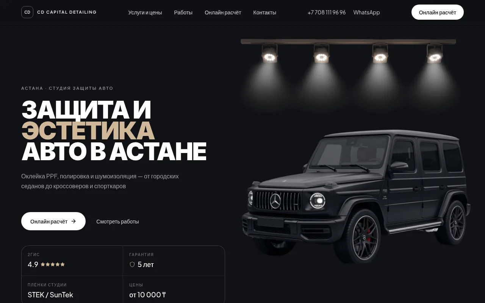

# Capital Detailing — лендинг детейлинг-студии

**Бизнес:** Capital Detailing, детейлинг-студия в Астане.

## Задача
Одностраничный сайт в тёмном стиле на реальных фото студии: услуги, работы, цены и быстрая заявка.

## Что сделано
- Первый экран, карточки услуг, блок «Стандарты»
- Галерея работ и процесс на фото студии
- Форма заявки с выбором класса кузова (цены лежат в одном файле pricing.ts), заявка уходит через серверный маршрут /api/lead
- FAQ, контакты и закреплённая панель связи

## Стек
TanStack Start и TanStack Router, React, TypeScript, Vite, Tailwind CSS 4, Radix UI, Framer Motion, Zod.

## Демо
https://capital-detailing-project.vercel.app

## Примечание
Исходное техническое задание лежит в docs/BRIEF.md.

---
Сделано с помощью AI-инструментов (Lovable, Cursor, AI-агенты) под моим руководством.
